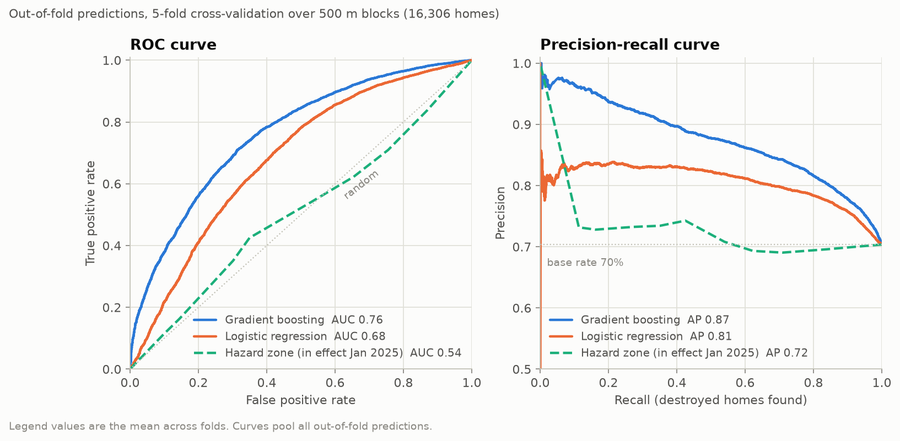
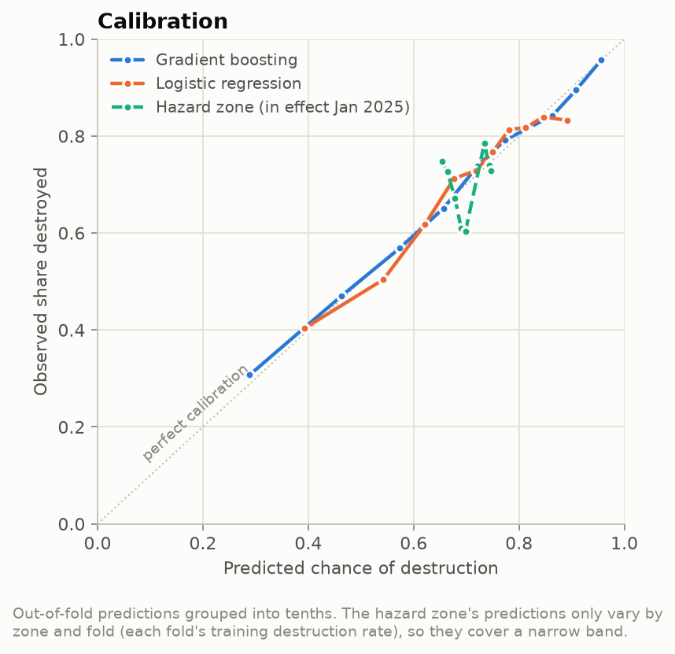
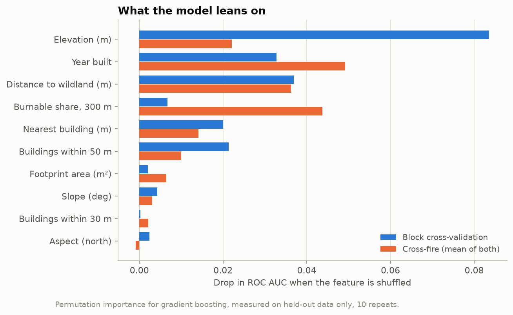
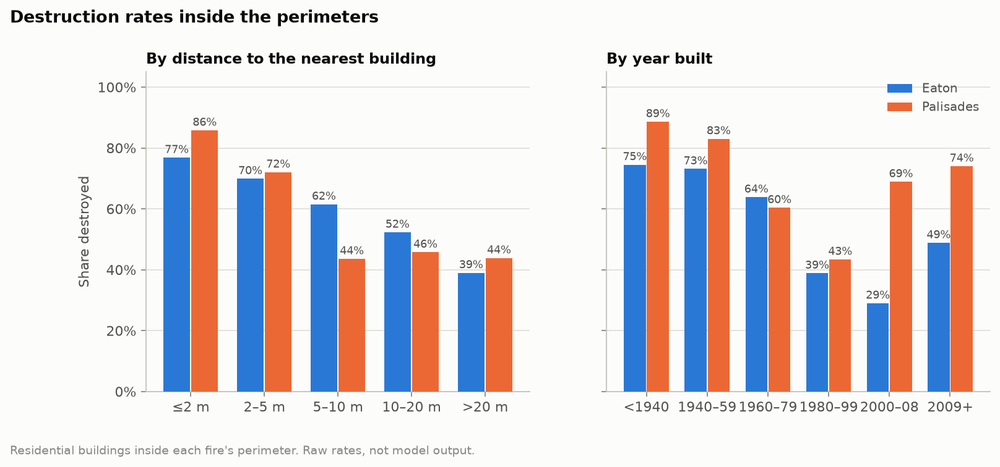
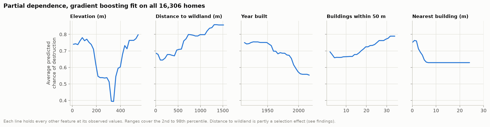
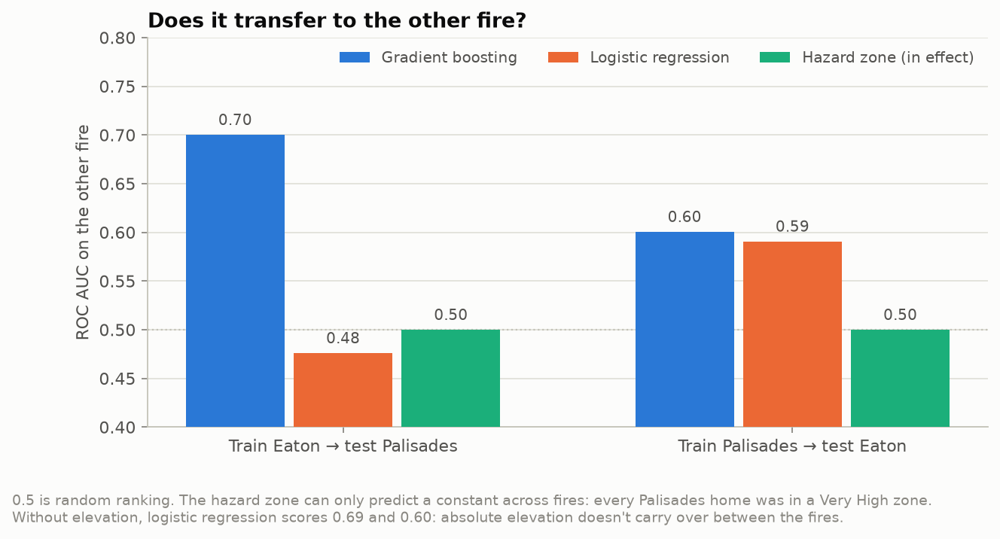

# Findings

For homes inside the January 2025 Palisades and Eaton fire perimeters, which features you could measure *before*
the fires best predicted whether a home was destroyed, and does a simple model built on them beat CAL FIRE's Fire
Hazard Severity Zones?

Every number here comes from `data/processed/model_metrics.json`, `data/processed/aggregates/` and the run logged in
`methodology.md`. The population is 16,306 residential buildings inside the two perimeters (8,560 in Eaton, 7,746
in Palisades), excluding the 81 that inspectors couldn't reach.

## Headline: the model beats the hazard map, but it's not a crystal ball

**70% of homes inside the perimeters were destroyed**, 70.4% in Eaton and 70.3% in Palisades. So "everything burned"
is already 70% accurate, and accuracy is the wrong yardstick. The question is ranking. Can you tell, ahead of time,
which homes were more likely to go?

| | ROC AUC | PR AUC | Brier |
|---|---|---|---|
| Base rate for everyone | 0.500 | 0.704 | 0.209 |
| Hazard zone in effect in January 2025 | 0.539 | 0.723 | 0.209 |
| 2025 LRA hazard zone (published after the fires) | 0.518 | 0.714 | 0.210 |
| Logistic regression | 0.679 | 0.813 | 0.190 |
| **Gradient boosting** | **0.758** | **0.873** | **0.171** |

Five-fold cross-validation over 500 m blocks, mean across folds. The gap between gradient boosting and the hazard
zone is 0.20 to 0.32 AUC (95% interval, resampling whole blocks).

**The official map carried almost no information about which homes burned inside these perimeters.** Every
Palisades home was in a Very High zone. In Eaton, the map pointed the wrong way: 57.6% of homes in the Very High
zone were destroyed, against 74.3% of homes outside any zone. That doesn't mean the map was wrong about the area. It
called nearly all of the Palisades burn area Very High, and it's built to say *where* fire is likely, not which house
on a street survives. But it means the map can't do the job this project tests. The 2025 update, published two
months after the fires, does no better here.

The model is also well calibrated. Grouped into tenths, its predicted chance of destruction is within 0.021 of the
observed share every time.

## The strongest predictors

**Year built.** Older homes burned more. In Eaton, 74-75% of homes built before 1960 were destroyed, against 29-39%
of those built 1980-2008. Year built is the top predictor when the model has to work across fires (permutation
importance 0.049). Newer homes were built to newer codes, which tend to mean details like enclosed eaves, finer vent
screens and dual-pane windows. Those are the features IBHS points to in its review of these fires
([Monroy et al. 2025](https://doi.org/10.82346/KYXN-NS13)), and in this data year built is the best stand-in for them.

**How close the neighbors are.** Homes with another building within 2 m were destroyed 77% (Eaton) and 86%
(Palisades) of the time, against 39% and 44% for homes with nothing within 20 m. Buildings within 50 m and distance
to the nearest building both rank in the top six. This is the structure-to-structure spread IBHS describes. Once
fire got into a dense neighborhood, houses ignited each other.

**Distance to wildland and surrounding fuel.** These matter a lot, but in the opposite direction from the usual
"homes on the edge of the brush are most at risk". Here, homes farther from wildland and with less burnable fuel
nearby were destroyed *more* often. Part of that is real: the dense interior neighborhoods burned house to house.
Part of it is selection, and it has to be said plainly. The study only includes homes inside the perimeter, and the
perimeter is drawn around what burned. A home 1.5 km from the brush is only in this study if the fire reached it.

**Partial dependence** shows the same shapes holding everything else fixed. Predicted destruction falls steadily
for homes built after about 1960, drops sharply once the nearest building is more than about 5 m away, and rises
with the number of buildings within 50 m.

**Slope, aspect, footprint size and fuel right at the building** barely matter once the rest is known (importance
under 0.007).

## Does it transfer from one fire to the other?

This is the honest test. Train on one fire and predict the other.

| Train → test | Gradient boosting | Logistic | Logistic without elevation | Hazard zone |
|---|---|---|---|---|
| Eaton → Palisades | **0.700** | 0.476 | 0.685 | 0.500 |
| Palisades → Eaton | **0.601** | 0.591 | 0.603 | 0.500 |

It transfers partly. A model trained only on Eaton ranks Palisades homes at 0.70, clearly better than the map and
not far off the 0.76 from block cross-validation. The other direction is weaker, at 0.60. One plausible reason is
terrain: 79% of Eaton homes sit on slopes under 5°, against 55% in Palisades, so a model trained on Palisades has
seen less of the flat, dense neighborhood that makes up most of Altadena. I haven't tested that explanation.

The cross-fire test also caught a real trap. Within one fire, **elevation** is the model's most useful feature,
because it marks where in that fire a home sits. In Eaton, homes up toward the foothills burned more. But it doesn't
transfer. Palisades homes go down to sea level, far below anything in Eaton, and logistic regression trained on
Eaton extrapolated so badly that it scored worse than a coin flip (0.476, with a Brier score three times worse than
predicting the base rate). Without elevation it scores 0.685. Gradient boosting doesn't extrapolate past what it
trained on, so it was protected. Without elevation it scores about the same across fires (0.703 and 0.596) and
0.715 within them. Elevation is real information, but most of it is about place, not about the house.

## What didn't change the answer

| Variant | Gradient boosting AUC | Hazard zone AUC |
|---|---|---|
| Main: Destroyed, inside the perimeters | 0.758 | 0.539 |
| Counting Major damage as destroyed | 0.756 | 0.539 |
| Adding homes up to 300 ft outside the perimeter (20,546, 56.8% destroyed) | 0.791 | 0.530 |
| Without elevation | 0.715 | 0.539 |

The 300 ft run scores higher only because it adds an easy group: homes just outside the line were almost all
spared.

## A model that looks great and means nothing

CAL FIRE's inspectors recorded each home's roof, eaves, vents, windows, siding, decks and fences. Those sound like
exactly what you'd want, and adding them lifts the model to **0.956**. The fields alone score 0.942.

It's leakage. Inspectors record those details *after* the fire. On a house that burned to the foundation, there are
no eaves left to classify, so they write "Unknown": for 71% of destroyed homes against 0.7% of survivors. A model
using just the "Unknown" flags scores 0.895. It isn't learning anything about construction. It's learning whether
there was enough house left to inspect. These fields are kept out of every result above, and this section exists to
show why.

## Limitations

**Two fires, one kind of weather.** Both burned under extreme Santa Ana winds, which push fire into neighborhoods and
then from house to house. Under ordinary conditions the wildland edge probably matters more and neighbor spacing
less. The gap between the two cross-fire scores (0.70 and 0.60) shows how much results move even between these two.

**The population is defined by the outcome.** Only homes inside the final perimeters are studied, and the perimeters
are drawn around what burned. That inflates effects tied to being deep inside the burn area, distance to wildland
most of all. A model that could be used *before* a fire would have to cover homes the fire never reached, and
there's no outcome for those.

**DINS coverage and quality.** DINS records what inspectors could see in the weeks after the fire.
The damage class is reliable, but the construction fields are compromised by the "Unknown" problem, so the model
can't test construction directly. Year built is a stand-in for it.

**Buildings and parcels.** Most footprints are 2008 captures marked unchanged in 2023, so a few recent additions may
be missing or outdated. 1.4% of inspected homes had no matching footprint and use the inspection point instead.
Parcel attributes describe the lot, and 19.6% of homes share a parcel with another building. Each home keeps its own
year built from DINS.

**Hazard map timing.** The map in effect in January 2025 was largely CAL FIRE's 2007-2011 generation for local areas,
with the 2023 state map in state-responsibility areas. The 2025 local-area map came out after the fires, and I can't
rule out that it was drawn with them in mind. Neither map was built to rank individual homes inside a burn area, and
the comparison is about that specific job.

**Correlation, not cause.** Year built, density and distance to wildland all travel together with neighborhood,
income, and when an area was developed. The model finds what predicted destruction. It doesn't show that changing
one feature would have saved a house.

## Files

- `data/processed/buildings_wildfire.parquet`: 22,152 residential buildings with features, outcome, flags, and
  out-of-fold predictions for the 16,306 in the main population (`oof_hgb`, `oof_logistic`, `oof_fhsz_in_effect`,
  plus `xfire_hgb` and `xfire_logistic` from the other fire's model)
- `data/processed/model_metrics.json`: every metric, split, sensitivity, calibration curve, importance and partial
  dependence
- `data/processed/aggregates/`: destruction rates by community, block group, hazard zone, build era and neighbor
  distance
- `data/processed/web/`: building points with outcome and predicted risk, perimeters, and fuel COGs in EPSG:4326
- `docs/figures/`: the six figures above
